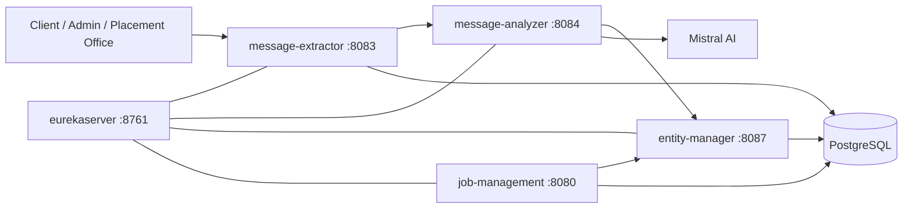

# HireTrack

HireTrack is a Spring Boot microservice system for managing placement-related information end to end. It ingests source messages and attachments, extracts structured placement data with AI assistance, stores the resulting entities, and exposes authenticated APIs for recruiters or administrators to read and manage the data.

This repository contains the production flow built around `message-extractor`, `message-analyzer`, `entity-manager`, `job-management`, and `eurekaserver`. The camelCase `messageAnalyzer` folder is a separate POC and is not part of the main workflow described here.

## What this project is

HireTrack centralizes the placement office workflow around three core objects:

1. source messages and uploaded files,
2. structured placement entities such as job listings, notifications, and shortlists,
3. authenticated views for students or internal users to browse the curated data.

The system is designed to reduce manual work when placement messages arrive in different formats such as PDFs, images, spreadsheets, or text snippets. Instead of storing raw messages only, the platform extracts text, classifies the content, links it to the correct job listing where possible, and persists the result as structured records.

## What problem it solves

Placement updates usually arrive through unstructured channels and in inconsistent formats. A single company update might arrive as a PDF, an image screenshot, a spreadsheet, or a plain-text message. That makes it difficult to search, normalize, link, and reuse the data consistently.

HireTrack solves that by:

1. accepting heterogeneous source messages,
2. extracting text from the source format,
3. using AI-assisted classification to determine whether the content is a job listing, update, shortlist, or notification,
4. storing normalized records in dedicated services,
5. exposing authenticated APIs to query the resulting placement data.

## System overview



### Service responsibilities

`eurekaserver`
is the service registry. The other services register with it so Feign clients can resolve service names instead of hard-coded hostnames.

`message-extractor`
is the ingestion layer. It stores the original source message, extracts text from PDFs, images, spreadsheets, presentations, or plain text, and forwards the extracted content to the analyzer service. It also exposes endpoints for editing, deleting, and checking whether a source message exists.

`message-analyzer`
is the classification layer. It sends the extracted text to Mistral AI, converts the response into structured placement objects, and forwards those objects to `entity-manager`.

`entity-manager`
is the write-side domain service. It persists job listings, notifications, and shortlists. It also links AI-generated updates back to existing job listings and handles cascading deletion of related records by source message id.

`job-management`
is the authenticated read-side service. It manages user accounts and JWT-based login, then serves job listings, eligible listings, notifications, and shortlists to logged-in users.

## How the workflow works

1. A source message is submitted to `message-extractor`.
2. `message-extractor` stores the raw message and extracts readable text based on the content type.
3. The extracted text is forwarded to `message-analyzer`.
4. `message-analyzer` asks the AI model to classify the message and shape it into structured objects.
5. Structured objects are sent to `entity-manager`.
6. `entity-manager` validates the source message exists, links updates to the right job listing when possible, and stores the normalized entities.
7. `job-management` reads the persisted entities and presents them through authenticated endpoints.

This division keeps ingestion, AI processing, persistence, and authenticated consumption separate.

## Technology stack

- Java 17
- Spring Boot 3.x
- Spring Cloud Eureka for service discovery
- Spring Cloud OpenFeign for service-to-service calls
- Spring Security and JWT for authentication in `job-management`
- Spring Data JPA for persistence
- PostgreSQL as the main database
- Apache PDFBox, Apache POI, and Tess4J for file text extraction in `message-extractor`
- Spring AI with Mistral integration in `message-analyzer`
- Lombok for boilerplate reduction

## Prerequisites

Before running the system locally, make sure you have:

- Java 17 installed
- Maven or the provided Maven wrapper available in each module
- PostgreSQL running locally or remotely
- A Mistral AI API key for `message-analyzer`
- Environment variables prepared for the database and JWT configuration

## Configuration

The services expect the following environment variables:

- `DB_URL`
- `DB_USER`
- `DB_PASSWORD`
- `JWT_KEY` for `job-management`
- `EXPIRATION_TIME` for `job-management`
- `MISTRALAI_API_KEY` for `message-analyzer`

The services use `spring-dotenv`, so you can keep those values in a local `.env` file for development if you prefer.

## Local setup

Run the services in this order:

1. `eurekaserver`
2. `entity-manager`
3. `message-extractor`
4. `message-analyzer`
5. `job-management`

### 1) Start Eureka

```bash
cd eurekaserver
./mvnw spring-boot:run
```

Eureka runs on port `8761`.

### 2) Start entity-manager

```bash
cd entity-manager
./mvnw spring-boot:run
```

This service runs on port `8087` and uses PostgreSQL.

### 3) Start message-extractor

```bash
cd message-extractor
./mvnw spring-boot:run
```

This service runs on port `8083` and uses PostgreSQL.

### 4) Start message-analyzer

```bash
cd message-analyzer
./mvnw spring-boot:run
```

This service runs on port `8084` and requires `MISTRALAI_API_KEY`.

### 5) Start job-management

```bash
cd job-management
./mvnw spring-boot:run
```

This service runs on port `8080` and uses PostgreSQL plus JWT environment variables.

## API usage

### `message-extractor` API

Base URL: `http://localhost:8083`

#### Create source messages

`POST /api/message`

Request body:

```json
{
	"messages": [
		{
			"caption": "TCS Off-Campus Hiring",
			"contentType": "application/pdf",
			"size": 248901,
			"timeStamp": "2026-10-16T09:30:00",
			"fileData": "BASE64_OR_BYTE_ARRAY_PAYLOAD"
		}
	]
}
```

Behavior:

- stores the raw source message,
- extracts readable text from the file type,
- forwards the extracted text to `message-analyzer`,
- returns the extracted output message list.

#### Check whether a source message exists

`POST /api/info`

Request body:

```json
123
```

This endpoint is used internally by the other services before they persist linked records.

#### Edit a stored message

`PUT /api/message`

Request body:

```json
{
	"timestamp": "2026-10-16T09:30:00",
	"originalText": "Original caption or extracted text",
	"editedText": "Updated caption or corrected text"
}
```

#### Delete a stored message

`DELETE /api/message`

Request body:

```json
{
	"timestamp": "2026-10-16T09:30:00",
	"messageList": [
		{
			"caption": "TCS Off-Campus Hiring",
			"contentType": "application/pdf",
			"size": 248901,
			"timeStamp": "2026-10-16T09:30:00",
			"fileData": "BASE64_OR_BYTE_ARRAY_PAYLOAD"
		}
	]
}
```

### `message-analyzer` API

Base URL: `http://localhost:8084`

#### Analyze extracted messages

`POST /api`

Request body:

```json
[
	{
		"sourceId": 123,
		"text": "TCS is hiring for Software Engineer role with registration link..."
	}
]
```

Behavior:

- sends the text to the AI model,
- classifies the message into one or more structured objects,
- forwards job listings, updates, notifications, or shortlists to `entity-manager`.

### `entity-manager` API

Base URL: `http://localhost:8087`

#### Create a job listing

`POST /api/job-listing`

```json
{
	"sourceId": 123,
	"companyName": "TCS",
	"offerType": "full-time",
	"category": "placement",
	"jobProfile": "Software Engineer",
	"jobDescription": "...",
	"stipend": "...",
	"accommodationAllowance": "...",
	"onConversionCTC": "...",
	"minCGPA": 6.5,
	"percentage10th": 60,
	"percentage12th": 60,
	"percentageDiploma": 0,
	"dateOT": "2026-10-20T10:00:00",
	"dateInterview": "2026-10-25T10:00:00",
	"deadline": "2026-10-18T23:59:59",
	"eligibleBranches": ["CS", "IT"],
	"eligibilityCriteria": ["No active backlog"],
	"workLocation": ["Pune"],
	"events": {},
	"selectionProcess": {},
	"registrationLinks": {}
}
```

#### Update a job listing

`PUT /api/job-listing`

Uses the same structure as the create payload, plus the persisted `id` field.

#### Create a notification

`POST /api/job-notification`

```json
{
	"companyName": "TCS",
	"jobRole": "Software Engineer",
	"sourceId": 123,
	"title": "Interview schedule updated",
	"body": "The interview has been postponed by one day."
}
```

#### Create a shortlist

`POST /api/shortlist`

```json
{
	"sourceId": 123,
	"companyName": "TCS",
	"shortlistRound": 1,
	"jobRole": "Software Engineer",
	"studentDetails": [
		{
			"firstName": "Aarav",
			"lastName": "Sharma",
			"email": "aarav@example.com"
		}
	]
}
```

#### Link a message update to an existing job listing

`POST /api/link`

```json
{
	"sourceId": 123,
	"companyName": "TCS",
	"jobRole": "Software Engineer"
}
```

#### Delete all entities tied to a source message

`DELETE /api`

Request body:

```json
123
```

### `job-management` API

Base URL: `http://localhost:8080`

#### Sign up

`POST /auth/signup`

```json
{
	"email": "student@example.com",
	"password": "secret123",
	"fullName": "Aarav Sharma",
	"branch": "CS",
	"cgpa": 8.1
}
```

#### Login

`POST /auth/login`

```json
{
	"email": "student@example.com",
	"password": "secret123"
}
```

The response contains a JWT token and username. Send the token as `Authorization: Bearer <token>` for protected endpoints.

#### Get the current user details

`GET /auth`

#### Update branch and CGPA

`PUT /auth/{cgpa}/{branch}`

Example:

`PUT /auth/8.3/CS`

#### List all job listings

`GET /api/job`

#### List job listings eligible for the logged-in user

`GET /api/job/eligible`

#### List all notifications

`GET /api/job/notification`

#### List notifications for a specific job listing

`GET /api/job/notification/{jobListingId}`

#### List shortlists for a specific job listing

`GET /api/job/shortlist/{jobListingId}`

## Important design decisions

The system uses separate services instead of one monolith so that ingestion, AI processing, persistence, and authenticated consumption can evolve independently.

`message-extractor` keeps raw source handling isolated from domain persistence. That makes it easier to support multiple file formats and to reprocess edited messages without touching the domain tables directly.

`message-analyzer` sits between raw text and structured storage. This is the layer that converts loosely formatted placement announcements into stable domain objects.

`entity-manager` owns the canonical write model for job listings, notifications, and shortlists. It also performs lookup and linking logic so updates can be attached to the most likely existing job listing.

`job-management` is intentionally read-oriented and authentication-focused. It does not own the primary write flow for placement entities; instead it gives authenticated users a clean way to query curated data.

JWT authentication is used for the user-facing read API because the data consumers need access control, while the internal services communicate through Feign and Eureka.

## Repository layout

- `eurekaserver/` service registry
- `message-extractor/` source ingestion and text extraction
- `message-analyzer/` AI classification and forwarding layer
- `entity-manager/` persistence for placement entities
- `job-management/` authenticated query and user management service
- `messageAnalyzer/` older POC branch, not part of the main workflow
